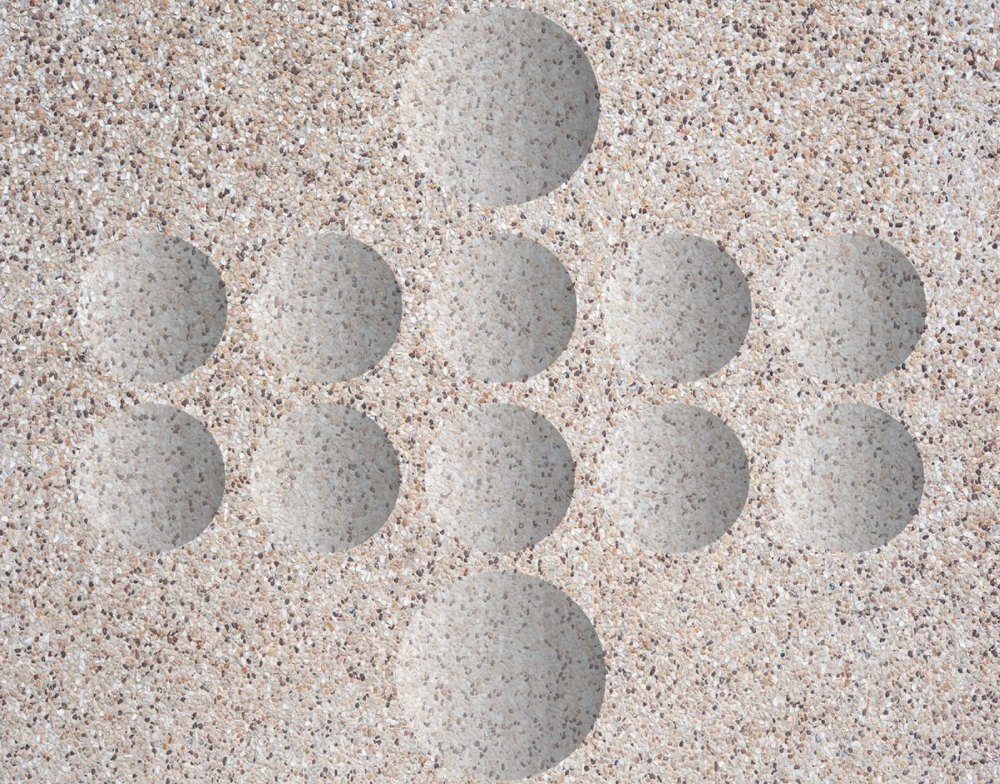

# Ngai



Le Ngai est un jeu traditionnel tupuri, un jeu de semis proche de l'awalé : des pions circulent dans
deux rangées de cinq trous, et l'on gagne en prenant ceux de ses adversaires.

Ce projet a deux buts : **écrire les règles complètes du Ngai** et **en faire un programme jouable**.
Il a commencé en 2018 dans le cadre d'un cours d'intelligence artificielle à l'École Nationale
Supérieure Polytechnique de Maroua.

- **Les règles :** [`docs/regles.md`](docs/regles.md), avec ce que l'on sait, ce que fait le
  programme, et les questions encore ouvertes.
- **Le rapport de 2018 :** [`docs/2018/rapport.pdf`](docs/2018/rapport.pdf) (source LaTeX :
  [`docs/2018/rapport.tex`](docs/2018/rapport.tex)). Il écrit le nom du jeu « Ngay ».

## Jouer

**En ligne, sans rien installer : [guidona.github.io/ngai-game](https://guidona.github.io/ngai-game/)**,
sur ordinateur ou sur téléphone.

Dans le terminal, il faut Python 3.9 ou plus récent, sans rien d'autre à installer. Depuis le
dossier du projet :

```sh
python3 ngai.py
```

Choisissez de jouer à deux ou contre l'ordinateur (facile, moyen ou difficile). Le joueur 1 (Sud)
joue avec les lettres `A` à `E`, le joueur 2 (Nord) avec les chiffres `1` à `5`. Tapez `?` pour
l'aide, `q` pour quitter.

```
    Joueur 2 (Nord) : 0 pion

      1    2    3    4    5
    +----+----+----+----+----+
    |  8 |  2 |  7 |  0 |  7 |
    +----+----+----+----+----+
    |  8 |  2 |  8 |  1 |  7 |
    +----+----+----+----+----+
      A    B    C    D    E

    Joueur 1 (Sud) : 0 pion

Joueur 2 (Nord) joue 4.

Joueur 1 (Sud), quel trou jouez-vous ? (? aide, q quitter)
```

## Où en est le projet

Le programme joue **une séance complète à deux joueurs** : à deux, ou contre l'ordinateur. Il gère
les 50 pions, le semis, les prises (gain simple et gain cumulatif) et la fin de la séance.

Le rapport ne dit pas tout. Quand une règle manque, le programme fait un **choix provisoire**, noté
dans [`docs/regles.md`](docs/regles.md) avec la question qui permettra de le confirmer. Pas encore
programmé : plus de deux joueurs, la propriété des trous et la suite des séances.

## Contribuer

Vous connaissez le Ngai ? L'aide la plus utile est de **répondre aux
[questions ouvertes](docs/regles.md#questions-ouvertes)** sur les règles : ouvrez une *issue* sur
GitHub, ou écrivez-moi. Pas besoin de savoir programmer.

Pour le code :

```
ngai.py              lance le jeu
ngai/
  plateau.py         le tableau et les règles
  ordinateur.py      l'adversaire ordinateur (minimax avec élagage alpha-bêta)
  terminal.py        l'affichage et la saisie
web/                 la version web (les mêmes règles en JavaScript, dans ngai.js)
tests/               les tests
docs/
  regles.md          les règles
  images/
  2018/              le rapport, sa source LaTeX et le carnet perceptron de 2018
```

Les tests se lancent avec `python3 -m unittest discover tests` et `node --test tests/web.test.mjs`
(ce dernier vérifie que la version web applique exactement les mêmes règles que la version Python).
Ils tournent aussi sur GitHub à chaque envoi. Une règle qui change se change donc à deux endroits :
`ngai/plateau.py` et `web/ngai.js`.

Pour essayer la version web en local : `python3 -m http.server -d web`, puis ouvrir
<http://localhost:8000>. Le jeu dans le terminal se lance aussi avec `python3 -m ngai`.

## Auteurs

Guy Mberebe Guidona et Oumar Djime Ratou.

---

*In English:* Ngai is a traditional Tupuri sowing game related to awalé. This project documents its
rules and implements them in Python, with a computer opponent. It is written in French because the
people who know the game and help with it are francophone. Play it online at https://guidona.github.io/ngai-game/ or run `python3 ngai.py`.
