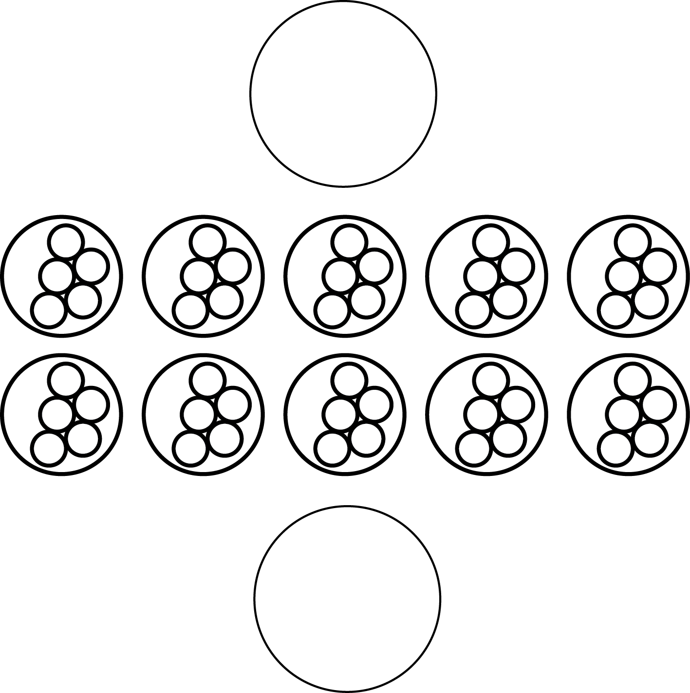

# Les règles du Ngai

Ce document rassemble ce que l'on sait des règles du Ngai, jeu traditionnel tupuri. Il reprend le
rapport de 2018 ([`2018/rapport.pdf`](2018/rapport.pdf)) et décrit ce que fait le programme actuel.
Le rapport écrit le nom du jeu « Ngay ».

Les règles ne sont pas encore complètes. Les points manquants sont listés à la fin, dans
[Questions ouvertes](#questions-ouvertes) : si vous connaissez le jeu, c'est là que votre aide compte
le plus.

## Selon le rapport de 2018

### Le matériel

- Un tableau de **10 trous**, creusés dans le sol ou dans le sable, répartis en **deux rangées de 5**.
- **50 pions**.
- Les pions circulent dans le **sens trigonométrique** (inverse des aiguilles d'une montre).

Le Ngai ressemble à l'awalé d'Afrique de l'Ouest, mais il est plus élaboré.

### Les joueurs et les trous

- Le Ngai se joue à plusieurs : **2 joueurs** idéalement, **10 au maximum**.
- Au début, on **distribue les trous** entre les joueurs. Pendant une séance, les propriétaires ne
  changent pas de trous.
- À la fin d'une séance, on constate à qui appartient chaque trou, et on refait la répartition selon
  les pions gagnés par chacun.
- Pour être **propriétaire légitime** d'un trou, il faut y mettre **au moins 3 pions** ; sinon, le
  trou passe à un autre joueur.

### Le but du jeu

- Le but est de prendre le plus de pions possible à ses adversaires.
- Le jeu est une **suite de séances**. Il se termine quand un seul joueur a gagné tous les trous de
  ses adversaires.
- Un joueur a gagné lorsqu'il a pris tous les pions, ou **au moins 48**, et occupe ainsi tous les
  trous du tableau.

### Les prises

On ne prend jamais qu'un **nombre pair de pions inférieur à 5**, c'est-à-dire **2 ou 4**, et cela
peut se faire dans **n'importe quel trou**. Il y a deux sortes de prises :

| | Gain simple | Gain cumulatif |
|---|---|---|
| Pions pris | 2 ou 4 | 2 ou 4 dans chacun des trous consécutifs qui remplissent la même condition |

Un **gain cumulatif** est une suite de gains simples. La suite de trous pris **ne doit pas dépasser
les angles de la rangée opposée**.

## Ce que fait le programme

Le programme ([`ngai/`](../ngai/)) joue **une séance à deux joueurs**, à deux ou contre l'ordinateur.
Il applique les règles du rapport. Là où le rapport ne dit rien, il fait un choix provisoire, marqué
*(choix provisoire, question n)* : la question correspondante est dans la section suivante, et le
choix changera dès que la réponse sera connue.

- **Le tableau.** Le joueur 1 (Sud) a la rangée du bas, trous `A` à `E`. Le joueur 2 (Nord) a la
  rangée du haut, trous `1` à `5`. Chaque joueur ne joue que depuis sa rangée. *(choix provisoire,
  question 7)*
- **Le départ.** Les 50 pions sont répartis à raison de **5 par trou**, comme sur le schéma du
  rapport. *(à confirmer, question 1)* Le joueur 1 commence. *(choix provisoire, question 2)*
- **Jouer un coup.** Le joueur choisit un de ses trous qui contient **au moins 2 pions**. *(choix
  provisoire, question 3)* Les pions sont semés un par un dans les trous suivants, dans le sens
  trigonométrique, y compris chez l'adversaire. Quand on fait le tour du tableau, on **saute le trou
  de départ**. *(choix provisoire, question 4)*
- **Les prises.** Si le dernier trou semé contient 2 ou 4 pions, le joueur les prend (gain simple).
  La prise continue sur les **trous suivants**, dans le sens du jeu, tant qu'ils contiennent 2 ou
  4 pions (gain cumulatif). Elle **ne dépasse pas l'angle** : elle reste dans la
  rangée du dernier trou semé, que ce soit celle de l'adversaire ou la sienne. *(choix provisoire,
  question 6)* Les pions pris vont dans le grenier du joueur.
- **Passer son tour.** Un joueur qui n'a aucun trou jouable passe son tour.
- **La fin de la séance.** Elle finit quand aucun des deux joueurs ne peut jouer, ou quand la même
  position revient (sinon les pions pourraient tourner sans fin). Chaque joueur prend alors les
  pions restés dans sa rangée, et le plus gros grenier gagne. *(choix provisoire, question 8)*
- **L'ordinateur.** Il cherche le meilleur coup en explorant les suites possibles (minimax avec
  élagage alpha-bêta) : 1 coup à l'avance en facile, 4 en moyen, 10 en difficile.
- **Pas encore programmé :** plus de deux joueurs, la propriété des trous (règle des 3 pions), la
  suite des séances avec redistribution des trous, la victoire à 48 pions.

L'erreur du programme de 2018 (une prise possible dans un trou qui n'avait pas été semé) est
corrigée.

## Questions ouvertes

Le rapport s'arrête avant d'expliquer ces points. Pour chacun, la réponse de quelqu'un qui joue au
Ngai permettra de compléter les règles puis le programme. Entre parenthèses, le choix provisoire du
programme.

1. **La répartition de départ.** Les 50 pions sont-ils toujours placés à 5 par trou au début ?
   *(oui : c'est ce que montre le schéma du rapport)*
2. **Le premier coup.** Qui commence, et comment le décide-t-on ? *(le joueur 1)*
3. **Les trous jouables.** Peut-on jouer un trou qui ne contient qu'un seul pion ? Peut-on jouer
   un trou qui n'est pas à soi ? *(non et non)*
4. **Le semis.** Quand un trou contient beaucoup de pions et que l'on fait le tour du tableau,
   saute-t-on le trou de départ ? *(oui, comme à l'awalé)*
5. **Le sens des prises cumulatives.** *Réglé :* après le dernier trou semé, la prise continue vers
   les trous suivants.
6. **Les angles.** Que veut dire exactement « ne pas dépasser les angles de la rangée opposée » ?
   Peut-on prendre dans sa propre rangée ? *(la prise reste dans une rangée ; oui)*
7. **Les trous des joueurs.** Comment les trous sont-ils répartis au début d'une partie à 2, à 3, à
   10 joueurs ? Comment s'applique la règle des 3 pions ? *(à deux : une rangée chacun)*
8. **La fin d'une séance.** Quand une séance se termine-t-elle ? Que deviennent les pions restés sur
   le tableau ? *(quand personne ne peut jouer ; chacun prend ceux de sa rangée)*
9. **La redistribution.** Comment refait-on la répartition des trous selon les pions gagnés ?
10. **Le nombre de joueurs.** Le rapport parle de 2 à 10 joueurs, mais aussi d'une version « pour
    cinq joueurs ». Quelle est la règle habituelle ?
